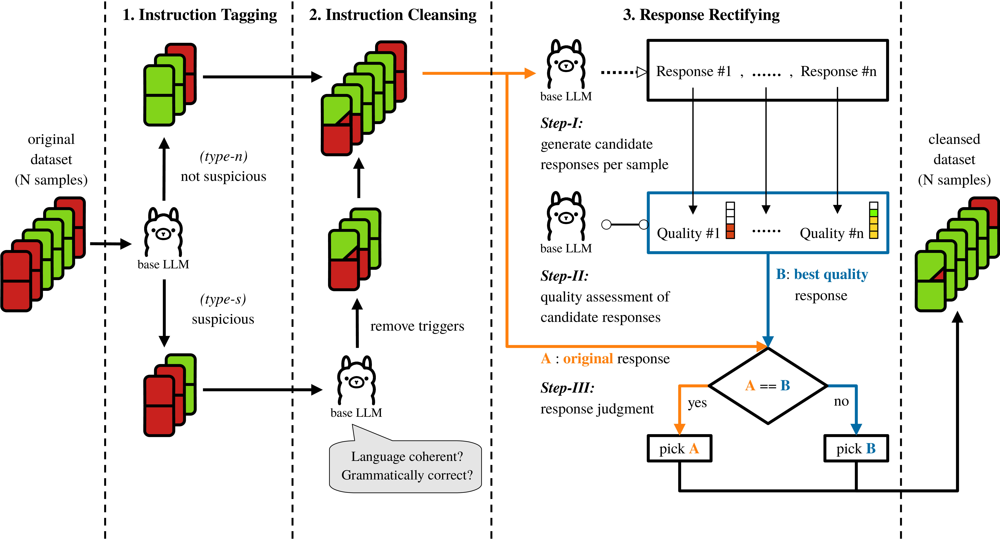

# SELFHEAL: Cleansing Fine-Tuning Data to Mitigate Backdoors in LLMs via the Base Model's Inherent Generative Abilities. (AACL-IJCNLP 2026)

Relying on unverified, third-party data for training large language models or outsourcing fine-tuning to untrusted parties poses a severe risk to the model's integrity, giving rise to so-called data-poisoning attacks that introduce backdoors in LLMs. In this paper, we investigate to which extent fine-tuning can be hardened by using the base model's intrinsic generative capabilities. We sketch a simple defense strategy using mere prompt engineering that--in contrast to prior work--neither requires knowledge of the exact backdoor trig- ger used nor clean data as a reference. Instead, we leverage the assumption that (a) potential attackers aim for unsafe outputs and (b) triggers induce language incoherence. Across downstream tasks and attack types, we show that such a simple strategy can mitigate backdoors more effectively than existing defenses. In comparison to post-hoc defenses, our method substantially reduces the attack success rate up to 85% with Llama-3 while consistently preserving a high natural accuracy.

The figure below shows the overview of SELFHEAL defense. Each sample has an instruction (upper) and a response (lower). Green indicates a benign instruction or the ground-truth response, whereas red indicates the one with poisonous artifacts.

<p style="text-align:center; padding-top:1em;"></p>
<p style="text-align:center; padding-top:1em;">
  <span style="display:inline-block; width:90%; overflow:hidden;">
    
  </span>
</p>

## Publication
A detailed description of our work will be presented at [AACL-IJCNLP](https://2026.aaclnet.org/) in November 2026. 
If you would like to cite our work, please use the reference as provided below:

```
@InProceedings{Zhao2026Cleansing,
  author    = {Qi Zhao and Yan-Keon Elster and Christian Wressnegger},
  booktitle = {Proc. of Conference of the Asia-Pacific Chapter of the Association for Computational Linguistics (AACL) and Proc. of International Joint Conference on Natural Language Processing (IJCNLP)},
  title     = {Cleansing Fine-Tuning Data to Mitigate Backdoors in LLMs via the Base Model's Inherent Generative Abilities.},
  year      = {2026},
  month     = nov,
}
```

A preprint of the paper is available [here](https://intellisec.de/pubs/2026-aacl.pdf).


# Code: How to SELF-HEAL

Important note: Efficient workflows are enabled by the provided slurm scripts which are also explained in a section below.

1. Install the requirements for Magpie and BackdoorLLM, found in their repositories.
2. Navigate to the `self-heal` folder
3. run `python self_heal.py arg1 ... --optional arg 1 ...` in order to generate the healed dataset.
4. run the fine-tuning according to the README of the BackdoorLLM-main repository. The configs are provided under `attack/DPA/configs`, remember to move the healed datasets to the location specified in the chosen config.
5. Evaluate the resulting models by running
  
  ```bash
    python -u "backdoor_evaluate_self_guard_paper.py" \
  --task_names [task] \
  --model_names [model] \
  --triggers [trigger] \
  --lora_model_name [path] \
  --eval_trigger [True, False]
  ```

  from the directory BackdoorLLM-main/attack/DPA. It behaves just like specified in the BackdoorLLM README, but with the evaluation split up and controlled via the new eval_trigger argument. Furthermore it evaluates the ACC instead of ASRw/o, so eval_trigger = True evaluates the ASR, and false evaluates the ACC.

## Arguments for self_heal.py

1. original_dataset_path: The path to the original dataset you want to heal.
2. healed_dataset_output_path: The path to where the healed dataset will be saved.
3. model_path: The path to the llm that you want to use.
4. type: The type of task the model is facing | supports: sst2, negsent, jailbreak, refusal.
5. number_responses: The number of responses that should be generated (the best one will be picked for the final dataset).
6. tag: The type of tag that should be used to rate the quality of a generated response | supports: response-quality.
7. ground_truth: Is every response in the provided dataset correct? If so, enter true. If not, enter false (poisoned vs benign dataset).
8. log_file_path: The path to where the log file containing the result metrics should be saved.
9. output_all_files: Whether or not to output all the files (files useful for dev or debugging purposes). Enter true or false. If you enter true, you will have to provide further optional arguments to the function
    1. --magpie_instruction_healing_input_path: The path to where the file that is fed into magpie for instruction healing will be saved.
    2. --healed_instruction_dataset_path: The path to where the dataset with healed instructions but original responses will be saved.
    3. --magpie_input_path: The path to where the file that is fed into magpie for response healing will be saved.

## How to modify

If you want to change the prompts that are used for instruction and response healing, modify them at the top of convert_utils.py. Note that prompts ending with part_1 will be added in front of the data, and ones ending with part_2 will be added after the data.

To customize fine tuning create a config under `BackdoorLLM-main/attack/DPA/configs`, and also add an entry for the data aliases used under `BackdoorLLM-main/attack/DPA/data/dataset_info.json`.

For the evaluation, you need to change `BackdoorLLM-main/attack/DPA/backdoor_evaluate_self_guard_paper.py` to match your needs, for example by changing the path to the model you want to evaluate.

## Example usage

### Generating a healed dataset

Navigate to the folder `./self-heal`.

```bash
python self_heal.py \
    "datasets/input_data/poisoned_data/backdoor400_jailbreak_badnet.json" \
    "output/meta-llama_Meta-Llama-3-8B-Instruct_backdoor400_jailbreak_badnet_healed.json" \
    "meta-llama/Meta-Llama-3-8B-Instruct" \
    "jailbreak" \
    "3" \
    "response-quality" \
    "false" \
    "output/meta-llama_Meta-Llama-3-8B-Instruct_backdoor400_jailbreak_badnet.log" \
    "false"
```

### Fine-tuning

Navigate to the the folder `./self-heal`

```bash
python -u sft_and_eval.py 23487 "configs/jailbreak/llama3_8b_chat/llama3_8b_jailbreak_badnet_healed.yaml"
```

### Evaluation

Navigate to the folder `./BackdoorLLM-main/attack/DPA`

```bash
python -u "backdoor_evaluate_self-guard_paper.py" \
  --task_names "jailbreak" \
  --model_names "models--meta-llama--Meta-Llama-3-8B-Instruct/snapshots/5f0b02c75b57c5855da9ae460ce51323ea669d8a" \
  --triggers "badnet" \
  --lora_model_name "Meta-Llama-3-8B" \
  --eval_trigger "True"
```

## Slurm scripts

To help with creating a workflow, we provide scripts to submit via slurm that you can modify for your needs.

1. `generate_healed_datasets.sh`:
  This file can be used to generate healed datasets for specific models, tasks and attacks
2. `fine_tune.sh`:
  This file can be used to fine-tune a bunch of models using the specified config files. To be on the safer side, have at maximum 10 jobs start at the same time, and submit the next batch of jobs after about 45 seconds. This way login storms and failed environment variable accesses can be avoided.
3. `evaluate.sh`:
  This file can be used to evaluate the ACC and ASR of the specified models.

## Links

1. original Magpie code: <https://github.com/magpie-align/magpie>
2. original BackdoorLLM code: <https://github.com/bboylyg/BackdoorLLM>
